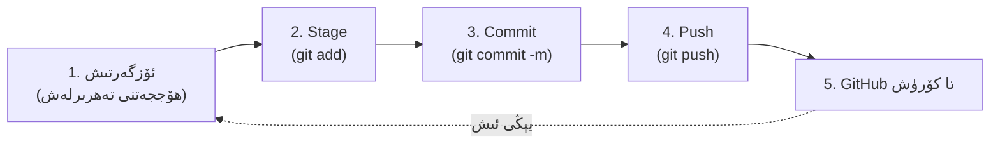

> **بۈگۈنكى نىشان:** دەرس ئاخىرىدا ھەر بىر كۇرسانتنىڭ (1) GitHub ھېسابى، (2) ئۆز ئامبىرى (Repository)، (3) چىرايلىق `README.md`، (4) VS Code تىن يوللانغان تۇنجى commit ى، (5) تورغا چىققان تۇنجى بېتى بولىدۇ.
> **بۇ كۈندىن باشلاپ:** كود تاپشۇرۇقلىرى پەقەت **GitHub ھېسابىنىڭ ئادرېسى** ئارقىلىق تاپشۇرۇلىدۇ.

---

## 1. دەرستىن بۇرۇنقى ئەسلەتمە

> **قۇرئان كەرىم:** ﴿وَقُل رَّبِّ زِدْنِي عِلْمًا﴾ — «ئېيتقىنكى: پەرۋەردىگارىم! ئىلمىمنى زىيادە قىلغىن.» *(سۈرە تاھا، 114-ئايەت)*

ئىلىم يېزىلمىسا، ساقلانمىسا يوقىلىدۇ؛ كودمۇ دەل شۇنداق، ساقلانمىسا ئۇنتۇلىدۇ. **GitHub — بىز يازغان ھەربىر قۇر كودنىڭ، ھەربىر ئۆزگىرىشنىڭ گۇۋاھچىسى.** ھازىرغىچە كومپيۇتېر بۇزۇلسا ھەممىسى يوقاپ كېتەتتى. بۈگۈندىن باشلاپ ھەربىر ئىشىمىز **بۇلۇتتا، ئۆز نامىمىز ئاستىدا، ھەربىر ئۆزگىرىش تارىخى بىلەن** ساقلىنىدۇ، ئىنشائاللاھ.

**3 ئەسلەتمە:**
1. **ئامانەت
2. **ئىتقان 
3. **ھەمكارلىق

---

## 2. گىتخاب GitHub دېگەن نېمە؟ (Git بىلەن GitHub پەرقى)

|           | **Git**                                               | **GitHub**                                                     |
| :-------- | :---------------------------------------------------- | :------------------------------------------------------------- |
| ماھىيىتى  | كومپيۇتېرىڭىزدا ئىشلەيدىغان **نەشىر باشقۇرۇش دېتالى** | گىت Git ئامبارلىرىنى **تورغا قويۇپ ساقلايدىغان سۇپا**          |
| ئوخشىتىش  | ۋورد Word دىكى «ئۆزگەرتىش ئىزى + ئەسلىگە قايتۇرۇش»    | گۇگېل درايۋ Google Drive غا ئوخشاش بۇلۇت، لېكىن كودچىلار ئۈچۈن |
| ئىنتېرنېت | كېرەك ئەمەس                                           | كېرەك                                                          |
| ئىگىسى    | ئوچۇق مەنبە، ھەقسىز                                   | شىركەت (Microsoft) سۇپىسى                                      |

**ئاددىي ئوخشىتىش:** Git — «خاتىرە دەپتىرى»، GitHub — «شۇ دەپتەرلەر قويۇلغان ئاممىۋى كۈتۈپخانا».

### 2.1 قىسقىچە تارىخ

|    يىل    | ۋەقە                                                                                                                                                                                           |
| :-------: | :--------------------------------------------------------------------------------------------------------------------------------------------------------------------------------------------- |
|   2004    | جون گرۇبېر John Gruber  ماركدوۋن Markdown تىلىنى كەشپ قىلدى (ئاددىي بەلگىلەر بىلەن تېكىست فورماتلاش)                                                                                           |
|   2005    | لىنۇس Linus Torvalds (Linux نى ياسىغۇچى) Linux يادرو كودىنى باشقۇرۇش ئۈچۈن **Git** نى بىر نەچچە ھەپتىدە يېزىپ چىقتى                                                                            |
|   2008    | توم Tom Preston-Werner، Chris Wanstrath، PJ Hyett (ۋە Scott Chacon) **GitHub** نى قۇردى                                                                                                        |
|   2018    | مىكروسوفت Microsoft  گىتخاب GitHub نى سېتىۋالدى (تەخمىنەن 7.5 مىليارد دوللار، پاي شەكلىدە)                                                                                                     |
| 2020–2025 | كوپايلوت Copilot، Actions، Codespaces، Pages… قاتارلىق ئىقتىدارلار بىلەن تولۇق «كود ئىكوسىستېمىسى» غا ئايلاندى؛ **AI Agent لىرى (Claude Code قاتارلىقلار) مۇ دەل Git/GitHub ئۈستىگە قۇرۇلغان** |

---

## 3. گىتخاب GitHub نىڭ مۇھىم رولى — نېمە ئۈچۈن ھەممە كود يازغۇچى ئىشلىتىدۇ؟

|  #  | رولى                           | بىزگە نېمە پايدىسى بار                                                                                                        |
| :-: | :----------------------------- | :---------------------------------------------------------------------------------------------------------------------------- |
|  1  | **ساقلاش ۋە زاپاس**            | كومپيۇتېر بۇزۇلسىمۇ كودىڭىز ساق قالىدۇ                                                                                        |
|  2  | **نەشىر تارىخى**               | ھەر ئۆزگىرىش (commit) خاتىرىلىنىدۇ؛ خاتا بولسا ئەسلىگە قايتۇرىمىز. AI كودنى بۇزۇپ قويسا ئەسلىگە قايتۇردىغان ئەڭ مۇھىم قالقان. |
|  3  | **ھەمكارلىق**                  | بىر نەچچە كىشى بىر تۈرگە ئورتاق ئىشلەيدۇ (Branch، Pull Request، Issue)                                                        |
|  4  | **ئۆز كىملىكىڭىز (Portfolio)** | ئىش ئىزدىگەندە، ھەمكارلىق ئىزدىگەندە «GitHub ئادرېسىڭىزنى ئەۋەتىڭ» دەپ سورىلىدۇ؛ سىزنىڭ **كود تەرجىمھالىڭىز**                 |
|  5  | **تورغا چىقىرىش**              | گىتخاب پېيجس GitHub Pages ئارقىلىق ھەقسىز توربەت ئېچىش                                                                        |
|  6  | **ئېچىق مەنبە بىلىم ئامبىرى**  | مىليونلىغان ھەقسىز تۈر؛ ئۆگىنىش ۋە ئىلھام ئېلىش                                                                               |
|  7  | **AI قوراللىرىنىڭ ئاساسى**     | كلائۇد كود Claude Code، Codex، Cursor… ھەممىسى Git ئامبىرىدا ئىشلەيدۇ؛ Skill ۋە MCP لار GitHub دىن قاچىلىنىدۇ                 |
|  8  | **ئاپتوماتلاشتۇرۇش**           | گىتخاب ئەكشېنس GitHub Actions: كود يوللىغاندا ئاپتوماتىك سىناش/تورغا قويۇش                                                    |

---

## 4. گىتخاب GitHub دىكى ئاساسىي ئۇقۇملار (لۇغەت)

س![[00 ئەمەلىي ئۆتۈلىدىغان دەرس/000 01 vibe_coding/week02/1710824963782.jpg|734]] س

س ![[main-qimg-ef6ba6c5b923f9c3967279f03974f456.webp|734]] س

س ![[pull-request-1.png|731]] س

س ![[Git Pull.png|735]] س

| ئاتالغۇ               | ئۇيغۇرچە چۈشەندۈرۈش                                       | ئوخشىتىش                                    |
| :-------------------- | :-------------------------------------------------------- | :------------------------------------------ |
| **Repository (Repo)** | ئامبار — بىر تۈرنىڭ بارلىق ھۆججەتلىرى + تارىخى            | بىر ھۆججەت قىسقۇچ + ئۇنىڭ «ئەسلىمە دەپتىرى» |
| **Commit**            | ئۆزگىرىشنى «ساقلاپ قويۇش نۇقتىسى» قىلىپ خاتىرىلەش         | ئويۇندا Save                                |
| **Push**              | يەرلىك commit لارنى GitHub قا يوللاش                      | دەپتەرنى كۈتۈپخانىغا تاپشۇرۇش               |
| **Pull**              | گىتخاب GitHub تىكى يېڭىلىقنى كومپيۇتېرغا ئېلىش            | كۈتۈپخانىدىن يېڭى نەشرىنى ئېلىش             |
| **Clone**             | گىتخاب GitHub تىكى ئامبارنى كومپيۇتېرغا تولۇق چۈشۈرۈش     |                                             |
| **Branch**            | شاخ — ئاساسىي كودنى بۇزماي سىناق قىلىش يولى               | ئاساسىي يولدىن ئايرىلغان سىناق يولى         |
| **Fork**              | باشقىلارنىڭ ئامبىرىنى ئۆز ھېسابىڭىزغا كۆچۈرۈپ ئېلىش       |                                             |
| **Pull Request (PR)** | «مېنىڭ ئۆزگەرتىشىمنى ئاساسىي كودقا قوشۇڭ» دەپ تەلەپ قىلىش |                                             |
| **README.md**         | ئامبارنىڭ «ئالدىنقى بېتى» — تونۇشتۇرۇش ھۆججىتى            | كىتابنىڭ مۇقاۋىسى                           |
| **.gitignore**        | گىت Git غا «بۇ ھۆججەتلەرنى يوللىما» دەيدىغان تىزىملىك     | مەخپىي ھۆججەتلەرنىڭ قالقىنى                 |
| **License**           | باشقىلار كودىڭىزنى قانداق ئىشلىتەلەيدۇ — ئىجازەتنامە      |                                             |
| **Star ⭐**            | ياقتۇرۇش/خەتكۈچلەش                                        |                                             |

بەك مۇھىم كود:

```shell
git init  
git config --global user.email "ss@gmail.com"  
git config --global user.name "userName"  
git add .  
git commit -m "initial commit"  
git branch -M main  
git remote add origin https://github.com/UyCoder/AI-Studio-Formatter.git  
git push -u origin main
```

### 4.1 خىزمەت ئېقىمىنىڭ 5 قەدىمى




---

كۈندىلىك خىزمەتنى تاماملاپ بولغاندىن كېيىن، كودلارنى Git ئامبىرىغا (Repository) ==يوللاش ئۈچۈن ئادەتتە تۆۋەندىكى **تۆت ئاساسلىق بۇيرۇقنى تەرتىپ بويىچە** ئىجرا قىلىش كېرەك==:

**1. ئۆزگەرتىشلەرنى قوشۇش (Stage):**  
ئالدى بىلەن سىز ئۆزگەرتكەن ياكى يېڭىدىن قوشقان ھۆججەتلەرنى يوللاشقا تەييارلايسىز.

```
git add .
```
_(ئەسكەرتىش: نۇقتا `.` بەلگىسى بارلىق ئۆزگەرتىلگەن ھۆججەتلەرنى بىرلا ۋاقىتتا تاللايدۇ)._

**2. ئۆزگەرتىشلەرنى مۇقىملاشتۇرۇش (Commit):**  
قوشۇلغان ھۆججەتلەرگە بۈگۈن نېمە خىزمەتلەرنى قىلغانلىقىڭىزنى چۈشەندۈرۈپ خاتىرە قالدۇرىسىز.
```
git commit -m "بۈگۈنكى خىزمەت مەزمۇنى ياكى چۈشەندۈرۈش"
```

**3. مۇلازىمېتىردىكى يېڭىلانمىلارنى ئېلىش (Pull - ئىختىيارىي):**  
باشقىلارنىڭ سىز بىلەن بىللە ئىشلىگەن كودلىرى بىلەن سىزنىڭ كودىڭىز توقۇنۇشۇپ قالماسلىقى ئۈچۈن، ئالدى بىلەن يېڭىلانمىلارنى تارتىپ تەكشۈرۈۋېلىش تەۋسىيە قىلىنىدۇ.
```
git pull origin <تارماق_نامى>
```

**4. كودنى مۇلازىمېتىرغا يوللاش (Push):**  
ئاخىرقى قەدەمدە، ئۆزىڭىزنىڭ كومپيۇتېرىدىكى كودلارنى يىراقتىكى (مەسىلەن GitHub, GitLab) ئامبارغا يوللايسىز.
```
git push origin <تارماق_نامى>
```
_(ئەگەر ئاساسىي تارماقتا بولسىڭىز، ئادەتتە `git push origin main` ياكى `git push origin master` بولىدۇ)._


## 5. گىتخاب GitHub دا يېڭى كود/تۈر ئىزدەش ئۇسۇلى

گىتخاب GitHub — دۇنيادىكى ئەڭ چوڭ **كود ئىزدەش ماتورى**. ئۆگىنىشتە ئەڭ كۆپ ئىشلىتىدىغان 6 ئۇسۇل:

### 5.1 ئاددىي ئىزدەش
ئۈستىدىكى ئىزدەش رامكىسىغا ئاچقۇچلۇق سۆز يېزىپ، سول تەرەپتىن **Repositories / Code / Issues / Users** نى تاللايسىز.

### 5.2 ئىزدەش ئۇسۇللىرىدىن مىساللار:

| مىسال                                  | مەنىسى                                                                       |
| :------------------------------------- | :--------------------------------------------------------------------------- |
| `chrome extension language:javascript` | جاۋاسكرىپت JavaScript بىلەن يېزىلغان Chrome قىستۇرمىلىرى                     |
| `todo app stars:>500`                  | 500 دىن ئارتۇق ⭐ ئالغان todo ئەپلىرى                                         |
| `topic:vibe-coding`                    | ۋايب كودىڭ vibe-coding تېمىسىغا بەلگىلەنگەن تۈرلەر                           |
| `pushed:>2025-06-01 claude`            | 2025-يىل 6-ئاينىڭ 1-كۈنىدىن كېيىن يېڭىلانغان، Claude ھەققىدىكىلەر            |
| `filename:SKILL.md`                    | ماھارەت Skill ھۆججىتى (SKILL.md) بار بارلىق ئامبارلار (5-ھەپتىدە ئىشلىتىمىز) |
| `filename:CLAUDE.md`                   | باشقىلارنىڭ CLAUDE.md نى كۆرۈپ ئۆگىنىش (4-ھەپتە)                             |
| `user:ئىشلەتكۈچى-نامى`                 | بەلگىلىك كىشىنىڭ تۈرلىرى                                                     |
| `license:mit`                          | ئېمئايتى MIT ئىجازەتلىك (ئەركىن ئىشلىتىشكە بولىدىغان)                        |

### 5.3 باشقا ئۇسۇللار
- قىزىق تېمىلار **Explore / Trending:** `github.com/trending` — بۈگۈن/بۇ ھەپتە ئەڭ قىزىق تۈرلەر.
- تېمىلار **Topics:** `github.com/topics/chrome-extension` — تېما بويىچە تۈرلەر.
- ئوۋسام **«Awesome» تىزىملىكلىرى:** `awesome-...` دەپ ئاتالغان ئامبارلار — بىر ساھەنىڭ ئەڭ ياخشى مەنبەلىرى (مەسىلەن `awesome-claude-code`، `awesome-chrome-extensions`). ئىزدەشنى `awesome claude` دەپ باشلاڭ.
- ئېيئاي **AI دىن سوراش:** «GitHub تىن Chrome قىستۇرمىسى يېزىشقا ئوخشايدىغان 3 ياخشى ئامبار تېپىپ بەر» — AI نىڭ جاۋابىنى ھەمىشە GitHub تا ئۆزىڭىز تەكشۈرۈڭ.

### 5.4 ئامبارنىڭ سۈپىتىنى دەسلەپكى تېز باھالاش

| تەكشۈرۈش       | ياخشى بەلگە                   | ئاگاھلاندۇرۇش                                                            |
| :------------- | :---------------------------- | :----------------------------------------------------------------------- |
| ئاخىرقى commit | يېقىندا (بىرنەچچە ئاي ئىچىدە) | 2 يىلدىن بۇرۇن                                                           |
| ⭐ سانى         | يۇقىرى (سۆھبەتكە ئاساسەن)     | 0 ⭐، تۇنجى كۈنلۈك                                                        |
| README         | ئېنىق، چىرايلىق               | بوش ياكى يوق                                                             |
| License        | MIT / Apache-2.0              | يوق (ئىشلىتىشكە بولمايدۇ دېگەن گەپ)                                      |
| Issues         | ئاكتىپ جاۋاب بېرىلگەن         | جاۋابسىز تۇرۇپ قالغان                                                    |
| كود            | ئوقۇشقا بولىدىغان             | مۇستەقىل قاچىلاش قوليازمىسى (`install.sh`) نىڭ ئىچىدە تونۇشسىز ئادرېسلار |

> ⚠️ **بىخەتەرلىك:** ناتونۇش ئامبارنىڭ قوليازمىسىنى (`.sh`, `.bat`, `.ps1`) ئىجرا قىلماڭ.

---

## 6. پروفىل (Profile) نىڭ مۇھىملىقى ۋە قانداق بېزەش

سىزنىڭ `github.com/user-name` بېتىڭىز — **ئاممىۋى كىملىك كارتىڭىز**. ئىش ئىگىسى، ھەمكارلاشقۇچى ۋە ئۇستازىڭىز ئاۋۋال شۇنى ئاچىدۇ.

### 6.1 پروفىل بېزەش ئېلېمېنتلىرى

| ئېلېمېنت              | قانداق قىلىنىدۇ                                                                                                      | تەكلىپ                                                                                |
| :-------------------- | :------------------------------------------------------------------------------------------------------------------- | :------------------------------------------------------------------------------------ |
| **Username**          | ھېسابات ئاچقاندا تاللىنىدۇ، ئادرېسقا ئايلىنىدۇ                                                                       | قىسقا، ئىنگلىزچە كىچىك ھەرپ؛ ھەقىقىي ئىسىم+يۈز+ئورۇننى بىللە ئاشكارىلىمايدىغان بولسۇن |
| **رەسىم (Avatar)**    | Settings → Profile                                                                                                   | يۈز سۈرىتى مەجبۇرىي ئەمەس؛ ئابستراكت/ئىسلامىي گېئومېترىيەلىك رەسىم ياخشى              |
| **Name / Bio**        | قىسقا تونۇشتۇرۇش (160 ھەرپ ئەتراپىدا)                                                                                | مەسىلەن: «AI بىلەن كود ئۆگىنىۋاتقان ئوقۇغۇچى · ئۇيغۇرچە قوراللار ياسايمەن»            |
| **Pinned repos**      | ئەڭ ياخشى 6 تۈرنى چوققىغا چاپلاش                                                                                     | ھەر ھەپتىنىڭ ياخشى تۈرلىرىنى كېيىن قىستۇرىمىز                                         |
| **Profile README**    | **ئۆز نامىڭىز بىلەن ئاتالغان** ئامبار (`ئىشلەتكۈچى-نامى/ئىشلەتكۈچى-نامى`) نىڭ README.md ى پروفىلنىڭ ئۈستىدە كۆرۈنىدۇ | بۈگۈن ئۆگىنىمىز، ئىنشائاللاھ                                                          |
| **Contribution grid** | يېشىل كاتەكچىلەر — قايسى كۈنى commit قىلغانلىقىڭىز                                                                   | ھەر كۈنى كەم دېگەندە 1 كىچىك commit                                                   |
| **2FA**               | ئىككى باسقۇچلۇق دەلىللەش                                                                                             | ⭐ مەجبۇرىي ئوقۇتۇلىدۇ                                                                 |

### 6.2 پروفىلدا قىلماسلىق كېرەك ئىشلار
- ⚠️ ئەمەلىي ئادرېس، تېلېفون نومۇرى، خىتايغا كېرەكلىك شەخسىي ئۇچۇرلاردىن ھېچنېمە يازماڭ. ئەمما شىركەتلەر تەلەپ قىلىدۇ.
- ⚠️ ئىسىم + يۈز + شەھەر/ئورۇن بىرلىكتە كۆرۈنمىسۇن. ئەمما شىركەتلەر تەلەپ قىلىدۇ.
- ⚠️ سىياسىي ۋە مەزھەبلىك بەتلەرنى پروفىلغا ئارىلاشتۇرماڭ؛ پروفىل — كەسپىي يۈزىڭىز.
- ✅ ئەڭ ياخشىسى: ئۆگىنىش نىشانى، ئىشلىتىدىغان قوراللار، 2–3 تۈر.

---

## 7. مارك دوۋن Markdown  قىسقا ئۆگىنىش

رېدمې `README.md` دىكى `.md` — **Markdown**. ئاددىي بەلگىلەر بىلەن چىرايلىق تېكىست ياسايدىغان تىل. ۋەھشىي يەڭگىل ئىشلەيدۇ.

| يازغىنىمىز                    | نەتىجىسى                                  |
| :---------------------------- | :---------------------------------------- |
| `# ماۋزۇ`                     | ئەڭ چوڭ ماۋزۇ (`##` ئوتتۇرا، `###` كىچىك) |
| `**قېلىن**`                   | **قېلىن** خەت                             |
| `*يانتۇ*`                     | *يانتۇ* خەت                               |
| `- نۇقتا`                     | تىزىملىك (بەلگە)                          |
| `1. بىرىنچى`                  | نومۇرلۇق تىزىملىك                         |
| `[تېكىست](https://...)`       | ئۇلانما (Link)                            |
| ``       | رەسىم                                     |
| `` `كود` ``                   | ئىچكى كود                                 |
| ` ```javascript ` ... ` ``` ` | كود بلوكى                                 |
| `> ئېلان`                     | نەقىل/ئەسكەرتىش                           |
| `\| ا \| ب \|`                | جەدۋەل                                    |
| `---`                         | ئايرىش سىزىقى                             |
| `- [ ] ۋەزىپە`                | تەكشۈرۈش رامكىسى                          |

مېرمېيد **Mermaid** (ئىلغار): GitHub تا «mermaid» كود بلوكى بىلەن بىۋاسىتە **خىزمەت جەريانى / سخېما** سىزغىلى بولىدۇ — بۇ دەرسلىكتىكى بارلىق سخېما مۇشۇنداق سىزىلغان.

---


### 7.1 ياخشى README نىڭ قۇرۇلمىسى

بۇنىڭ ئۈچۈن سىز كۆپرەك ئۇچۇرىڭىزنى بېرىپ ئېيئايدىن پايدىلىنىپ يازدۇرسىڭىز بولىدۇ. ئۆرنەك ئۈچۈن باشقىلارنىڭ رېدمې ھۆججىتىنى كۆچۈرۈپ بەرسىڭىز تېخىمۇ تېز پۈتتۈرەلەيسىز.

---

## 8. 2-سائەت · مەشغۇلات 1: GitHub ھېساباتى ئېچىش

> ⚠️ ھەممەيلەن بىر ۋاقىتتا ئىشلەيدۇ. ئۇستاز ئېكرانىنى ئورتاقلىشىپ، ھەر قەدەمنى كۆرسىتىدۇ. توسالغۇ كۆرۈلسە، دەرھال «قول كۆتۈرۈش».

> ℹ️ تور/رايون چەكلىمىسى ياكى ھېسابات ئېچىشتا خاتالىق چىقسا، ئېكران كەسمىسىنى ئېلىپ ئۇستازغا ئېيتىڭ. ھېچقاچان باشقىلارنىڭ ھېسابىنى ئىشلەتمەڭ.

---

## 9. مەشغۇلات 2: Git نى سەپلەش

1-ھەپتىدە Git قاچىلاندى. تەكشۈرۈپ، ئىسىم-ئېلخەتنى بەلگىلەيمىز. **PowerShell** ياكى VS Code ئىچىدىكى Terminal نى (Terminal → New Terminal) ئېچىڭ:

```powershell
git --version
git config --global user.name "ئىشلەتكۈچى-نامى"
git config --global user.email "12345+نام@users.noreply.github.com"
git config --global init.defaultBranch main
git config --global --list
```

-  ئىشلەتكۈچى `user.name` — commit لاردا كۆرۈنىدىغان ئىسىم (Username نى يازساق بولىدۇ).
- مېين `main` — يېڭى ئامبارنىڭ دەسلەپكى ئاساسىي شېخى.


---

## 10. مەشغۇلات 3: VS Code بىلەن GitHub


**تېرمىنالدا :**
```powershell
git status
git add week02/hello.md
git commit -m "Add hello.md for week02"
git push
git log --oneline
```

###  كۈندىلىك 3 بۇيرۇق ئادىتى

| ۋاقىت | ئىش |
| :--- | :--- |
| ئىش باشلاشتىن بۇرۇن | `git pull` (Sync) — يېڭىلىقنى ئېلىش |
| ئىش جەريانىدا | كىچىك-كىچىك commit (1 ئىش = 1 commit) |
| ئىش تۈگىگەندە | `git push` (Sync) — GitHub قا يوللاش |

> ⭐ ئېيئاي **AI بىلەن ئىشلىگەندە ئالتۇن قائىدە:** AI كود ئۆزگەرتىشتىن **بۇرۇن commit قىلىڭ**. 

### 10.7 گىتئىگنور `.gitignore` ۋە مەخپىي ھۆججەتلەر
- ئېيپىئاي كىي API Key، پارول، `.env` ھۆججىتى — **ھەرگىز** يوللانمايدۇ. `.gitignore` ئىچىگە `.env` يېزىلغانلىقىنى تەكشۈرۈڭ.
- ئەگەر خاتا يوللاپ قويسىڭىز: شۇ Key نى دەرھال بىكار قىلىپ (Revoke)، يېڭىسىنى ياسىڭ. ئەمما ئامبارنى ئۆچۈرۈش يېتەرلىك ئەمەس (تارىختا يەنىلا ساقلىنىپ قالىدۇ).

---

## 11. مەشغۇلات 4: Profile README + تۇنجى توربەت


> 💡 **ئوڭدىن سولغا (RTL):** GitHub Markdown دا ئۇيغۇرچە ئىشلەتكەندە، بۇ بۇيرۇق بىلەن بىر بۆلەكنى ئوڭدىن سولغا قىلىشقا بولىدۇ:
> ```html
> <div dir="rtl">
> ## uyghur ئۇيغۇرچە مەزمۇنلار
> </div>
> ```

## يېڭى رېپو قۇرغاندىن كېيىن قىلىدىغان مۇھىم ئىش:


```bash
git init
git config --global user.email "ss@gmail.com"
git config --global user.name "userName"
git add .
git commit -am "initial commit"
git remote add origin https://github.com/UyCoder/AI-Studio-Formatter.git
git push origin master

```


### 11.2 گىتخاب GitHub Pages بىلەن تۇنجى توربەت


> ✅ **تەكشۈرۈش:** تېلېفونىڭىزدا ئادرېسنى ئېچىپ كۆرۈڭ.

---

## 14.  ئەسكەرتىش

| خەتەر                                  | چارە                                                                             |
| :------------------------------------- | :------------------------------------------------------------------------------- |
| ھېسابات ئېچىشتا تور/كود دەلىللەش ئاستا | ئاۋۋال ئېلخەت ئىچىدە ئالدىن تەييارلاش؛ ئۆيدە تەييارلانمىغانلارغا جۈپ بەلگىلەش    |
| گىت Git قاچىلانمىغان كومپيۇتېر         | ۋىگېت `winget install --id Git.Git -e` (ياكى git-scm.com دىن)                    |
| پۇش `push` پارول سورايدۇ               | گىتGit Credential Manager بىلەن توركۆرگۈچتە دەلىللەڭ؛ پارول ئەمەس، Token/Browser |
| ئۇيغۇرچە قىسقۇچ نامى                   | ئىنگلىزچە ئىسىم ئىشلىتىڭ (1-ھەپتە قائىدىسى)                                      |


---
