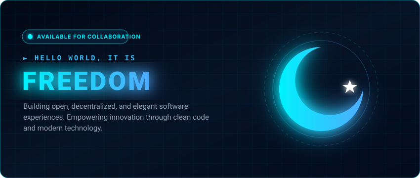

  

---

### 🌐 About Me
- 🔭 ئوپېن-سۆرس (Open-source) ۋە مەركەزلەشتۈرۈلمىگەن تۈرلەر ئۈستىدە ئىشلەيمەن.
- 🌱 ھازىر ئىلغار سىستېما تېخنىكىلىرىنى ۋە پۇختا كود يېزىشنى ئۆگىنىۋاتىمەن.
- 💬 تېخنىكا ۋە يۇمشاق دېتال تەرەققىياتى توغرىسىدا پىكىر ئالماشتۇرالايمىز.

---

### 🛠️ Tech Stack

  
  
  
  
  
  
  
  

---

### 📊 GitHub Stats

  

  

